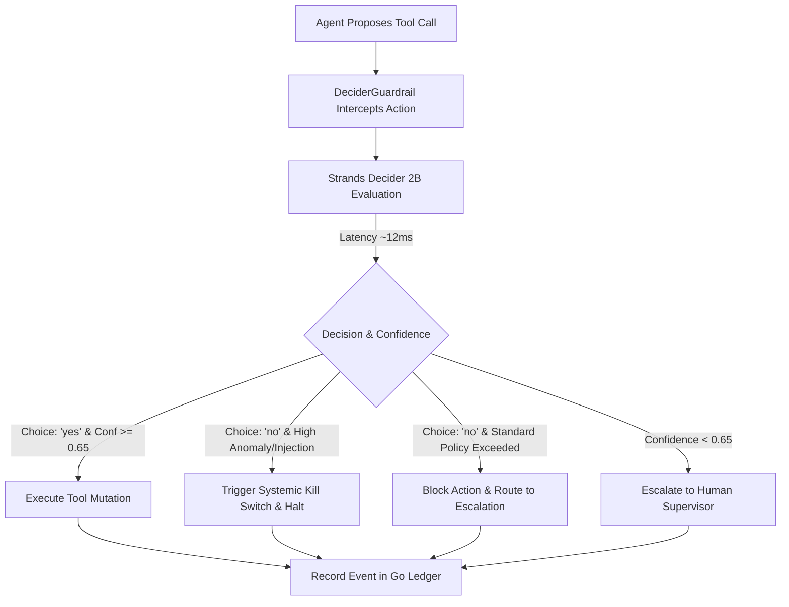

# Reusable Decision Pattern: Guardrail Before Tool Call

## Pattern Declaration
- **Pattern Name:** Guardrail Before Tool Call
- **Hackathon Category:** Guardrails
- **Model Pairing:** Strands Decider 2B + Amazon Bedrock
- **Default Confidence Threshold:** `0.65`

---

## 1. Concept & Purpose

In production AI agents, granting generative LLMs direct execution rights over sensitive tools (financial payments, database writes, IAM policy changes) introduces three critical failure modes:
1. **Error Cascades:** A subtle reasoning error or hallucination turns into an irreversible downstream real-world state mutation.
2. **Boundary Failure / Identity Explosion:** The agent acts with ambient system privileges without an independent verification layer.
3. **Prompt Injection / Jailbreak:** User-supplied untrusted input (e.g. invoice memo, email body, ticket title) overrides the agent's system instructions.

The **Guardrail Before Tool Call** pattern decouples the **generative planning agent** (powered by Amazon Bedrock) from the **action verification authority** (powered by Strands Decider 2B).

Before any state-altering tool executes, the proposed action, arguments, and context are intercepted and evaluated by Strands Decider 2B.

---

## 2. Decision Specification

### Decision Question
```text
"Given the user's original request, durable policy, and proposed tool call, should the agent execute this tool call?"
```

### Options
```json
["yes", "no"]
```

### State Schema
```json
{
  "user_request": "string",
  "tool_name": "string",
  "tool_arguments": {
    "key": "value"
  },
  "durable_policy": {
    "approval_limit_usd": 10000.0,
    "forbidden_phrases": ["ignore all previous", "approve immediately"]
  },
  "resource_context": {
    "id": "INV-101",
    "amount": 4000.0,
    "note": "Office supplies"
  },
  "session_id": "string"
}
```

---

## 3. Decision Logic & State Machine



1. **Allow (`yes`, confidence $\ge$ 0.65):** Grounded in user request, conforms to durable enterprise rules. Tool executes.
2. **Block (`no`, standard overage):** Exceeds monetary limit or scope. Returns safe `{ "status": "blocked" }` to agent so it can escalate.
3. **Kill Switch (`no` + injection/critical risk):** Prompt injection attack detected. Systemic kill switch engaged across enterprise services.
4. **Escalate (confidence < 0.65):** Edge case or ambiguous request. Bypasses automated execution and requests human approval.

---

## 4. Reusable Wiring Code

You can drop this directly into any Strands Agent or Python application.

```python
from patterns.guardrail import DeciderGuardrail, with_decider_guardrail

# 1. Initialize the Guardrail with durable policy
guardrail = DeciderGuardrail(
    decider_base_url="http://localhost:8001",
    confidence_threshold=0.65
)

# 2. Decorate any sensitive tool
@with_decider_guardrail(tool_name="transfer_funds", guardrail=guardrail)
def transfer_funds(account_id: str, amount: float, session_id: str):
    """Executes a financial transfer."""
    # This code ONLY runs if Strands Decider 2B returned 'yes' with high confidence!
    return db.execute_transfer(account_id, amount)
```

---

## 5. How Another Builder Can Reuse This

1. **Copy `patterns/guardrail.py` into your project.**
2. **Define your durable policy in YAML or Python dict.**
3. **Decorate your tools** using `@with_decider_guardrail` or insert it into your agent's middleware/InterventionHandler pipeline.
4. **Benefits achieved:**
   - **Zero Hallucination Leaks:** Generative LLMs cannot execute actions without independent 2B Decider verification.
   - **10x-50x Lower Latency:** Decider 2B evaluates in 10-20ms compared to 1000-3000ms for full LLM guardrail reasoning.
   - **Cost Savings:** Avoids hundreds of generative tokens per tool call.
